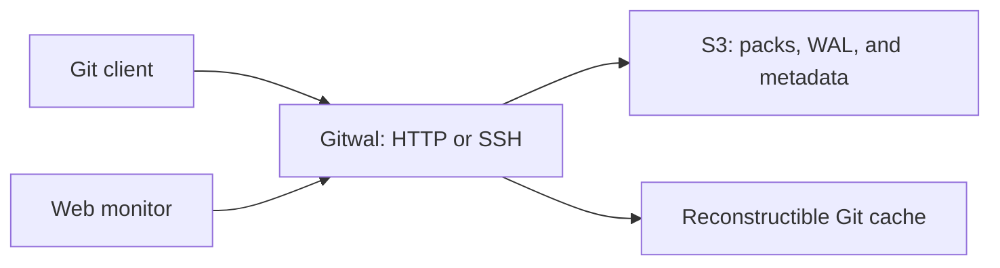

# Gitwal

**Git hosting over HTTP and SSH, backed by S3-compatible object storage.**

Gitwal stores Git packs, repository metadata, and a write-ahead log in object
storage. Local repositories are reconstructible caches. Push, clone, and fetch
work with standard Git clients.

- Atomic pushes, branches, tags, ref deletion, and thin packs.
- SHA-1 and SHA-256 repositories.
- Private repositories with token-based access control and public read access.
- Conditional writes, multipart uploads, and recovery from lost write responses.
- WAL compaction, local cache management, and repository locks.
- A web monitor for published references and WAL state.



## Quick start

Requires Docker with Linux containers and Docker Compose. The supplied images
target Linux x86-64.

```sh
git clone https://github.com/devzolo/zolo-gitwal.git
cd zolo-gitwal
docker compose up -d --build --wait
```

Open the [web monitor](http://localhost:8080). The development stack also provides
a [RustFS console](http://localhost:9001), using
`gitwal-local` / `gitwal-local-development-secret`.

Ports bind to `127.0.0.1` by default. For deployment, configure your own credentials
and HTTPS as described in the [operations guide](docs/docker.md).

## Push your first repository

Generate a token from the Compose directory. In PowerShell:

```powershell
$token = (docker compose exec -T gitwal zolo-gitwal token).Trim()
```

In a POSIX shell:

```sh
token=$(docker compose exec -T gitwal zolo-gitwal token)
```

Then, inside a local Git repository with at least one commit:

```sh
git -c "http.extraHeader=Authorization: Bearer $token" push http://localhost:8080/demo.git HEAD:refs/heads/main
git -c "http.extraHeader=Authorization: Bearer $token" clone http://localhost:8080/demo.git
```

The first valid push creates a private repository owned by that token. Keep it
for future pushes, clones, and monitor access. Gitwal stores only its SHA-256
hash. The monitor keeps the token in memory without adding it to URLs or browser
storage. Bearer and Basic (`username:token`) authentication are supported.

SSH is available through the optional Compose profile. See the
[SSH guide](docs/ssh.md) for approved keys, access control, and client setup.

## Documentation

| Guide | Contents |
| --- | --- |
| [Configuration](docs/configuration.md) | Storage, credentials, limits, and cache settings |
| [Docker and operations](docs/docker.md) | Deployment, volumes, maintenance, and SSH |
| [HTTP API](docs/api.md) | Git endpoints, repository access, and metadata updates |
| [SSH](docs/ssh.md) | Key configuration and forced-command integration |
| [Architecture](docs/architecture.md) | Durable publication, replay, compaction, and concurrency |
| [Testing](docs/validation.md) | Unit and integration suites, coverage, and reproduction |

## Build from source

Gitwal is written in [Zolo](https://github.com/devzolo/zolo-lang) and uses
[zolo-object-store](https://github.com/devzolo/zolo-object-store) for storage.
Install [Zolo 0.1.8-alpha](https://github.com/devzolo/zolo-releases/releases/tag/v0.1.8-alpha)
and Git. Native builds require Rust 1.97.1 and a C/C++ linker.
Dependencies are pinned in `zolo.toml` and `zolo.lock`.

```sh
zolo install
zolo run tools/render_monitor.zolo
zolo check src/main.zolo
zolo build src/main.zolo --release --emit native -o target/zolo-gitwal
```

For a local run, set the required [environment variables](docs/configuration.md)
and use `zolo run src/main.zolo`. Run `zolo run src/main.zolo -- --help` for the
`token`, `hash-token`, `gc`, and `ssh` commands.

## Run tests

```sh
docker compose --profile test run --rm --build --no-deps unit
docker compose --profile test run --rm --build smoke
```

The integration suite uses real Git clients and object storage. The
[testing guide](docs/validation.md) covers storage concurrency, multipart,
compaction, restart recovery, and SSH checks.

## Storage and resource requirements

Gitwal uses its own versioned WAL layout. Object storage is authoritative;
the local Git cache can be reconstructed. Back up the bucket and retain
sufficient disk space for temporary packs, caches, and compaction.

Transfers are streamed, with intermediate files used before validation and
publication. The cache budget is a maintenance target rather than a hard quota.
SSH fetch does not apply the HTTP fetch byte limit. Historical S3 objects are
retained until a separate retention policy removes them. See
[architecture](docs/architecture.md) for the persistence contracts.
